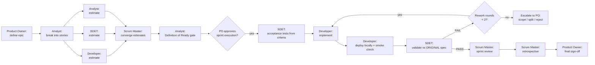

# CrewAI Scrum Team

A demonstration of a multi-agent Scrum team built with
[CrewAI](https://www.crewai.com/) running on a **local Ollama model** —
no paid APIs, no API keys, no cloud LLM calls.

Five agents play a Scrum team: **Product Owner, Business Analyst,
Scrum Master, Developer, and SDET**. They take a business epic through
stories, joint estimation, readiness and done gates, ATDD acceptance
tests, local deployment, and validation against the **original**
spec — the way a best-performing Scrum team would, including the
uncomfortable parts: estimation disagreements, failed readiness
checks, rework loops with a cap, and scope control.

## The team

| Agent | Owns |
|---|---|
| **Product Owner** | The epic: business goal, scope, explicit out-of-scope. Owns the backlog — only the PO reprioritizes it. Approves sprint execution and signs off the increment. |
| **Business Analyst** | Breaks epics into small INVEST-shaped stories with acceptance criteria, dependencies, and risks. Owns the Definition of Ready gate. |
| **Scrum Master** | The flow: planning, standups, review, retrospective, blockers, WIP limits. Converges estimates and flags divergence. Enforces the rework cap and escalates to the PO. Carries retro actions into the next sprint. |
| **Developer** | Implements stories (code references the story id), keeps tests green, deploys locally, and smoke-checks. Estimates independently before convergence. |
| **SDET** | Writes acceptance tests FROM the acceptance criteria (ATDD), then validates the deployed increment against those same criteria. The validation report is a traceability matrix: every criterion → test(s) → verdict → evidence. No verdict without a cited criterion. |

Why five roles and not the four originally sketched? Without a Scrum
Master, nobody owns the flow — ceremonies, blockers, and WIP limits
belong to no one. See [docs/design.md](docs/design.md) for every
design decision and its reasoning.

## How a sprint flows



Key rules the workflow enforces (all implemented in
`scrum_crew/pipeline.py`, tested without any LLM):

- **Joint estimation, no silent averaging.** Developer, SDET, and
  Analyst estimate each story independently in Fibonacci points. If
  the highest and lowest are more than one Fibonacci step apart, the
  story is flagged DIVERGENT with no locked value — the Scrum Master
  facilitates a discussion first.
- **Definition of Ready gate.** A story enters a sprint only if its
  criteria are clear, dependencies identified, estimate locked at 8
  points or fewer, and it is marked testable.
- **ATDD order.** Acceptance tests are written from the criteria
  before/with implementation, and validation reuses those same
  criteria — the SDET tests what was promised, not what was built.
- **Rework capped at 2 rounds.** A third validation failure escalates
  to the Product Owner instead of looping forever.
- **Scope control.** Requirements discovered mid-sprint go to the
  backlog, never into the running sprint.
- **Definition of Done gate.** Code with story-id references, tests
  passing, criteria validated, local deploy + smoke green, docs
  updated — all five, or it is not Done.

## Layout

```
scrum_crew/
  agents.yaml      one agent per role (CrewAI YAML config)
  tasks.yaml       one task per workflow stage (planning + execution)
  crew.py          crew assembly: sequential process, allow_delegation=False
  tools.py         minimal tools: file read/write, pytest runner
  pipeline.py      pure-stdlib workflow rules (DoR/DoD, convergence,
                   traceability, rework cap) -- no CrewAI import, so
                   tests run without CrewAI installed
  run.py           --demo (scripted) and real crew modes
demo_app/          Team Task Board API (stdlib only): tasks with
                   title/status/assignee/priority, CRUD + validation
examples/sample-run/
                   canned agent outputs for the worked example:
                   epic, stories, estimates, test mapping, ceremony notes
scripts/preflight.py
                   setup checker: installs missing pip deps when
                   testing, checks Ollama, prints fix commands
tests/             pytest suite for pipeline.py + demo_app
docs/design.md     every design decision + modification, with reasoning
```

## Quickstart: scripted demo (no LLM needed)

The scripted demo is the honest way to verify this repo without an
LLM: it replays canned agent text through the **real** pipeline and
runs demo_app's pytest suite **for real**. If the tests fail, the
demo fails.

```bash
python3 -m venv .venv
.venv/bin/pip install pytest
.venv/bin/python -m pytest tests/ -q
.venv/bin/python -m scrum_crew.run --demo
```

Expected demo output: STORY-1..3 (create, list/filter, update) pass
estimation, the Ready gate, validation, and Done. STORY-4 (delete)
is deliberately the disagreement case — Developer 8, SDET 3, Analyst
5, two Fibonacci steps apart — so it is flagged DIVERGENT, fails the
Ready gate, and stays in the backlog for an estimation discussion.
The demo writes `outputs/validation_report.md` (the traceability
matrix) and `outputs/sprint_summary.md`.

## Real crew run (on a machine with Ollama)

```bash
ollama serve
ollama pull qwen3:8b
.venv/bin/pip install -r requirements.txt
.venv/bin/python -m scrum_crew.run          # gates ask for PO approval
.venv/bin/python -m scrum_crew.run --auto   # skip gates (unattended)
```

Progress: a real run prints the plan upfront (numbered tasks with
agent names), then one line per finished task with elapsed time and
the next task, plus a phase total — the same lines are appended to
`outputs/progress.log`. Model reasoning traces stay off
(`verbose=False`), so the terminal shows where the run is without
flooding it.

Model strategy: the default model for **all** roles is `qwen3:8b`,
the daily-driver local model and the strongest choice that runs at
usable speed on a CPU-only Intel Mac. Override with `OLLAMA_MODEL`,
or per role with e.g. `DEVELOPER_MODEL`. CrewAI reaches Ollama
through LiteLLM (`ollama/<name>` at `http://localhost:11434`).
`qwen3-coder:30b` is documented as the optional Developer upgrade on
stronger hardware — it is deliberately not the default, because 30B
models are too slow on CPU. Keep tool use minimal per agent: small
local models are fragile with complex tool chains, so agents produce
structured Markdown artifacts instead of long tool loops.

Preflight (also wired into pytest via `tests/conftest.py`, skippable
with `SCRUM_SKIP_PREFLIGHT=1`) checks the Python version, installs
missing pip packages, and checks Ollama reachability — it prints fix
commands but never installs Ollama or downloads models.

## Honest limitations

- **"Deploy" means local only.** The Developer starts the app server
  on localhost and smoke-checks it. There is no cloud target, no CI
  deploy, and no production environment in this repo.
- **The scripted demo uses canned agent text.** The pipeline checks,
  the traceability matrix, and the tests are real; the agent prose
  is not. The demo proves the workflow machinery, not the model's
  judgment.
- **Small-model tool-use limits.** With qwen3:8b, long tool chains
  are unreliable, which is why each agent gets at most three simple
  tools and tasks demand structured artifacts.
- **The real crew run is unverified until it runs on a machine with
  Ollama.** Sandbox verification covers crew construction (agents and
  tasks load from YAML, the crew object builds) but not a full LLM
  kickoff — there is no Ollama in the sandbox.
- **In-memory demo storage.** The Task Board loses tasks on restart.
  That is accepted, documented tech debt for the worked example, not
  a recommendation.

## License

MIT — see [LICENSE](LICENSE).
